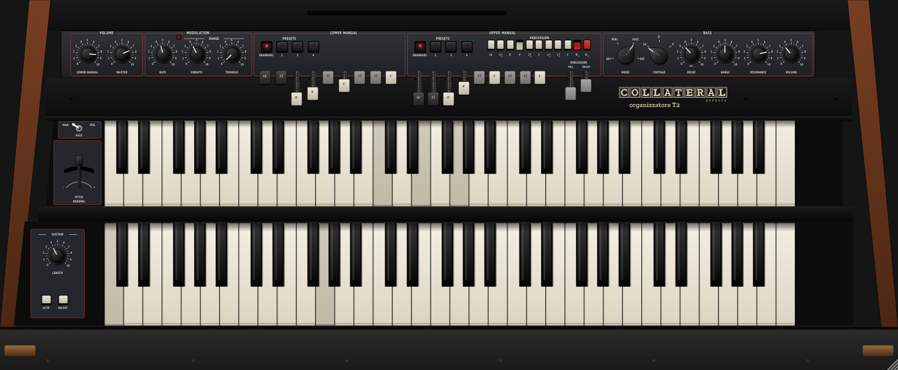

# Organizzatore T2 — emulazione del Crumar Organizer T2 (VST3 / AU / Standalone)

Plugin strumento in C++17 con JUCE 8, marchio **Collateral Effects**. Riproduce l'organo a due manuali
Crumar Organizer T2 seguendo il manuale d'uso, il manuale di servizio T1-T2 e gli schemi elettrici del T2
(schede P-xxx, disegni DWG). "Organizzatore" è un nome provvisorio.



## Architettura (dagli schemi)

| Scheda originale | Emulazione |
|---|---|
| **P-489 Oscillatore principale** (DWG 2) | 2,00024 MHz. PITCH BENDING ±1 tono; VIBRATO dal LFO tramite la 560 kΩ sul punto A (al massimo ±4,2 %, circa ±0,7 semitoni). Vibrato e pitch bend agiscono su tutto lo strumento, bassi compresi, come nell'originale. |
| **P-489 LFO** | Integratore 470n‖470n + trigger di Schmitt 10k/68k: triangolo ±1,9 V, periodo 12,2 ms · (1 + Rrate/10 kΩ) con il potenziometro RATE da 1 MΩ logaritmico (circa 0,8 … 80 Hz; 6 Hz a metà scala circa). Il LED lampeggia con la quadra. Doppio clic sulla manopola RATE o clic sul LED: pulsante on/off della modulazione. |
| **P-485/P-486 MK50240 + HBF4727** | Due generatori d'ottava (uno per manuale, fasi indipendenti), divisori 478 … 253 e 239: 97 frequenze da Do1 a Do9, intonazione del chip (scarto massimo 1,2 cent). Tutte le ottave di una nota sono in fase come nei divisori binari; le mutazioni (5⅓', 2⅔', 1⅗', 1⅓') sono temperate. Sopra Do9 i piedi acuti ripiegano di un'ottava. |
| **P-480…483 TDA 0470 D** (549 interruttori) | Onda quadra 0/15 V commutata dal tasto; corrente ∝ (Vbc + 3,9 V)/103 kΩ, quindi il volume è lineare con la tensione Vbc e si spegne sotto −3,9 V. |
| **P-497 / P-527** (drawbar, preselettori, percussione) | Manuale superiore: Vbc = −(1,5 V · (1 − drawbar/8) + Vperc): i drawbar coprono 1,5 V, la percussione gli altri 2,5 V (può essere più forte dei drawbar). Manuale inferiore: drawbar su tutti i 4 V. Preselettori come la tabella di verità dei 4016 (100 kΩ in parallelo = metà livello): **2** = 16' 5⅓' 8' (888000000), **3** = 16' + 2' a metà, **4** = pieno. |
| **Percussione** | Condensatore da 2,2 µF scaricato durante il GATE e ricaricato con (33 kΩ + DECAY 220 kΩ) · 2,2 µF: 73 … 560 ms. Trigger singolo (riparte solo dopo aver rilasciato tutti i tasti), si somma a tutti i tasti tenuti. Esclusa quando il sustain è acceso. |
| **GATE PERCUSSIONE** (≈10 ms) | Al primo tasto premuto l'uscita dei filtri è cortocircuitata per circa 10 ms (contro i click di commutazione), poi il suono parte netto. |
| **K1, K2 (PIK)** | Impulso brevissimo (≈25 µs) alla fine del gate, filtrato 470k/120 pF e sommato all'uscita tramite 2,2 MΩ: un "tic" d'attacco di circa 0,1 ms. K2 lo attenua (47 kΩ verso massa). Il condensatore del monostabile, segnato "1µ5", è letto come 1,5 nF: con 1,5 µF l'impulso durerebbe 23 ms e si sentirebbero due colpi secchi, simili a una distorsione. |
| **P-509 Filtri d'ottava** (DWG 11) | Sette filtri passa-basso di 3° ordine (cella RC 47 k + filtro a reazione multipla), uno per ottava di frequenza, tarati come prescrive il manuale: trimmer sulla massima ampiezza al Sol dell'ottava (98, 196 … 6272 Hz). Le quadre diventano quasi sinusoidali (3ª armonica −30 … −43 dB), il guadagno d'ingresso (12 k … 68 k) e l'accoppiamento d'uscita (470n – 8,2k – 470n su 2,7 k) tengono il livello entro circa ±5 dB su tutta la tastiera. |
| **P-525 Sustain** (DWG 4) | 61 moduli: al rilascio la tensione del tasto si scarica e la nota svanisce (prima le armoniche più deboli). LENGTH regola la durata; AUTO taglia le code appena si preme un nuovo tasto (resta solo l'ultimo accordo). Il pedale di sustain (CC 64) equivale a ON. |
| **P-499 M 147 + P-502** (DWG 13, 14) | Basso monofonico a priorità sulla nota più bassa, 24 tasti (prime due ottave del manuale inferiore) o pedaliera da 18 note. Somma pesata (22k/39k/82k/150k) delle uscite di piede: dente di sega **a gradini** — 16 gradini al 16', 8 all'8', 4 al 4'. Impulso TP a ogni nuova nota prioritaria, livello TS a tasto tenuto. In MAN. le due ottave basse non suonano le armoniche (barra staccata). |
| **P-491 VCF bassi** (DWG 15) | Due CA3080 con condensatori da 1,5 nF e JFET, controreazione RESONANCE dall'uscita: dal passa-basso (Q 0,5) al passa-banda (Q ≈ 4,8). Inviluppo: 10 µF caricato dal gate, scarica su 10 k + DECAY 470 k log (0,1 … 4,8 s). La corrente degli OTA è proporzionale a inviluppo × RANGE, quindi lo stesso filtro fa da amplificatore: quando l'inviluppo cala il suono si chiude. MODE: OFF / PERC. / SUST. / OFF. |
| **P-493 Uscita** (DWG 16) | Manuali nel CA3080 del tremolo (ingressi 2,7 kΩ su 47 Ω, saturazione morbida sui pieni forti), profondità ±48 %; bassi e click entrano direttamente nel 741. LOWER MANUAL agisce come un potenziometro da 100 kΩ caricato dall'ingresso. |

## Valori ricostruiti o stimati

- **F1, F2, F3 e F6**: con i condensatori disegnati la taratura del manuale non è possibile (il filtro
  resterebbe 20–40 dB sotto gli altri); si usa la rete di F4 scalata d'ottava. F4, F5 e F7 sono come da schema.
- **Preselettori del manuale inferiore**: la tabella di verità della P-527 non è stampata. Dagli interruttori
  presenti (U1…U8, niente 16', 5⅓', 1⅗') sono ricostruiti così: 2 = 8' + 4' a metà, 3 = 8' 4' 2⅔', 4 = 8' più
  4', 2', 1⅓', 1' a metà.
- **K2 da solo** dà il click attenuato (nello schema K2 attenua soltanto: senza K1 non si sentirebbe nulla).
- Durate del **sustain**, livelli assoluti in volt e regolazione degli OTA sono stimati dai componenti, non misurati.

## Uso con la tastiera MIDI (Arturia KeyLab)

- **Split** (predefinito, una sola tastiera): sotto il Do4 (nota 60) il manuale inferiore, dal Do4 in su il superiore.
  Do2 (nota 36) è il primo tasto di ogni manuale. Con i bassi su **MAN.** le prime due ottave del manuale inferiore
  (Do2–Si3) suonano solo il basso, come sull'originale: con lo split al Do4 la mano sinistra suona quindi il basso.
  Per suonare accordi sul manuale inferiore porta la levetta su **PED.** (il basso passa alla pedaliera, canale 3)
  oppure sposta lo split più in alto dal menu del logo.
- **Canali** (dal menu del logo): 1 = manuale superiore, 2 = inferiore, 3 = pedaliera. Le note fuori estensione
  sono riportate d'ottava.
- Assegnazioni predefinite (modalità User della KeyLab): i 9 **fader** sui drawbar (CC 73 75 79 72 80 81 82 83 85,
  dal menu possono passare al manuale inferiore), le 9 **manopole** su RATE, VIBRATO, TREMOLO, volume e durata della
  percussione e sui 4 comandi dei bassi (CC 74 71 76 77 93 18 19 16 17), rotella di modulazione sul vibrato, CC 7
  MASTER, CC 11 pedale d'espressione, CC 64 sustain, pitch bend sulla leva PITCH BENDING. Se la KeyLab manda altri
  CC: **clic destro** su qualunque comando → *MIDI Learn*. Le assegnazioni si salvano con il progetto.
- **Clic sul logo**: modo della tastiera MIDI, punto di split, fader, accordatura (PITCH sul retro), qualità.
- I drawbar si **trascinano in giù** (0 … 8) o con la rotellina; doppio clic riporta un comando al valore iniziale.

## Compilazione

La build macOS (universale Apple Silicon + Intel) la fa GitHub Actions a ogni push su `main`: l'archivio
`Organizzatore-macOS` compare tra gli artefatti dell'esecuzione; con un tag `v*` viene creata anche una Release.
Dentro c'è `Installa Organizzatore.command`, che copia i plugin in `/Library/Audio/Plug-Ins` e l'app in `/Applicazioni`.

In locale:

```
cmake -B build -DCMAKE_BUILD_TYPE=Release
cmake --build build --target Organizzatore_VST3 Organizzatore_AU Organizzatore_Standalone
```

Test del motore: `c++ -O2 -std=c++17 -Isrc tests/engine_test.cpp -o engine_test && ./engine_test`
(intonazione, uniformità dell'8', gate, percussione, sustain, bassi, CPU).
Demo audio: `tests/render_demo.cpp`.

## Crediti

Font PT Sans / PT Sans Narrow (ParaType) e Zilla Slab (Typotheque per Mozilla), SIL Open Font License (vedi `resources/fonts`).
Crumar e Organizer T2 sono marchi dei rispettivi titolari; questo progetto non è affiliato al produttore originale.
